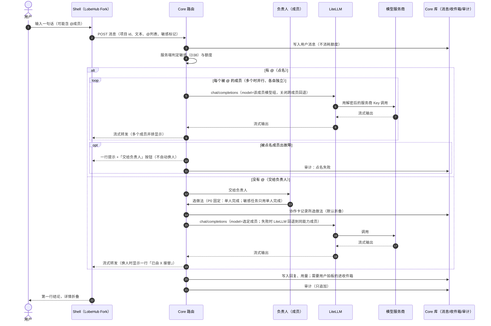
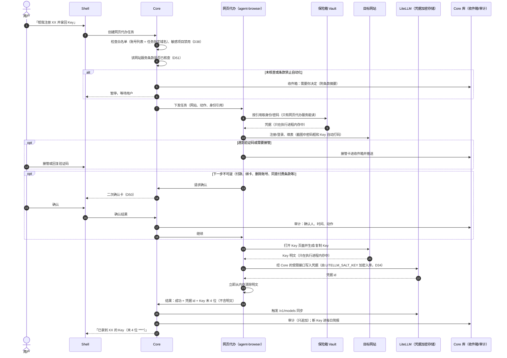
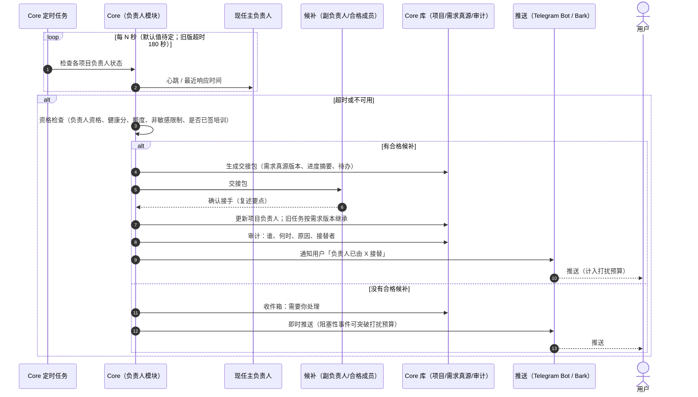

# 核心流程时序图与数据权威来源（SEQUENCES.md）

> 对应决策：DECISIONS D45（每类数据只有一个权威来源，并画三条核心流程的时序图）、D31（讨论模式）、D34（Key 加密存储）、D36/D38/D50/D51（白名单、敏感不外发、不可逆二次确认、先查服务条款）。
> 对应章节：PRODUCT 5.2、9.3、9.4/9.4.1、9.7、12、16.1。
> 状态：设计稿（2026-10-27），代码尚未实现；实现时如与本图不符，先改本图再改代码。
> 参与者名称：**Shell** = Aroomo Shell（LobeHub Fork）；**Core** = Aroomo Core；**LiteLLM** = 成员网关；**Vault** = 保险箱（9.6 secret 命名空间）；**Browser** = 网页代办服务（agent-browser）。

## 1. 发一句话

P0 只实现「点名」和「交给负责人 → 单人完成」；审查 / 辩论 / 并行对比是 P1（D31）。

要点：
- 用户在界面上看不到模式开关：有 @ 即点名，无 @ 即交给负责人（D31）。
- 点名请求在 LiteLLM 侧不做跨成员回退（否则等于自动换人）；同一成员的多个来源之间是否允许回退：**待负责人确认**。
- 额度紧张时多人做法降为单人完成，并计入后台任务限额（D31、D46）。

## 2. 网页代办拿 Key

要点：
- Key 明文从不出现在界面、消息、日志、截图、模型上下文、仓库里；Core 和界面只拿到凭据 id、末 4 位和状态。
- 截图与审计保存 30 天（PRODUCT 9.7）；审计日志只追加，不可删除。
- 写入 LiteLLM 的接口只对网页代办服务开放（白名单权限，D36）。

## 3. 负责人换人

由 Core 定时任务驱动，不依赖有人打开页面（回应 AUDIT P10）。

要点：
- 注意区分：这里是**产品内**的负责人（PRODUCT 9.3）。开发团队的主程序员换人规则见 D42/D43，不走本流程。
- 超时默认值、资格检查的具体条件：**待负责人确认**（AUDIT P10 建议，旧版 180 秒）。

## 4. 每类数据的唯一权威来源

规则：每类数据只有一个可写的权威来源；其他地方只能缓存或展示，以权威来源为准；冲突时以权威来源覆盖缓存。

| 数据 | 唯一权威来源 | 其他地方的副本 | 备注 |
|------|--------------|----------------|------|
| 服务商 Key / 凭据 | LiteLLM 数据库（salt key 加密） | Core 只存凭据 id、末 4 位、状态 | D34，KEY-STORAGE.md |
| 模型组 / 路由回退配置 | LiteLLM 数据库 | Core 缓存只读 | 成员到模型组的映射见下行 |
| 成员档案（名字、能力标签、负责人资格、健康分、绩效） | Core 库（Member、Source） | Shell 展示 | Source 记 LiteLLM 部署 id |
| 用量与花费 | LiteLLM 花费记录 | Core 汇总给圆环和简报 | 花费日志为明文，不存提示词 |
| 对话消息与会话 | Shell（LobeHub）数据库 | Core 只存路由记录和引用 id | 待 P0 验证 LobeHub server 模式的存储方式 |
| 需求真源、意见台账、协作卡（所选做法） | Core 库 | Shell 渲染 | D31 |
| 收件箱、每日简报 | Core 库（InboxItem） | 推送只是通知 | |
| 审计日志 | Core 库 AuditLog（只追加） | 无 | 不可删除（PRODUCT 0.4） |
| 网站账号、身份、密码 | 保险箱 Vault | Account 表只存引用 | 只有网页代办服务能读 |
| 网页流程 | Core 库（Flow） | 无 | |
| 收藏 | Karakeep | Core 只存 Item id、核实状态 | P0 不含收藏 |
| 公共记忆（RegistryFact） | Core 库 | OpenMemory 为检索副本 | |
| 官方域名表 | Core 库（D37） | 无 | 「已核实」只由服务端判定 |
| 部署配置与机密（salt key 等） | 服务器 `.env` | 恢复密钥加密的离线备份 | 不进仓库 |
| 需求与决策文档 | 仓库 docs/（PRODUCT、DECISIONS） | 无 | |

未验证：LobeHub server 模式下会话存储与 Core 的边界、OpenMemory 是否在 P0 部署，均待 P0 部署时确认（PRODUCT 第 20 节）。
